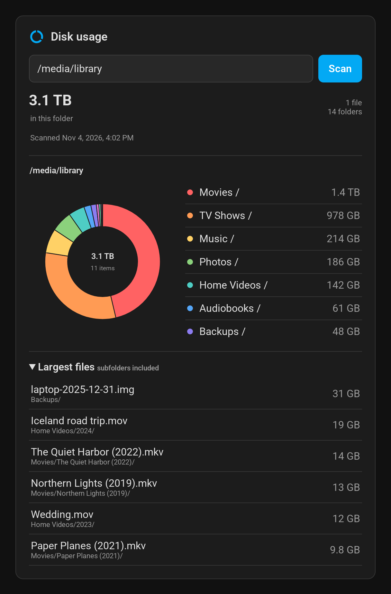

# Disk Usage Explorer

[](https://github.com/jeromelefeuvre/ha-disk-usage-explorer/actions/workflows/validate.yml)

A Home Assistant integration and dashboard card that scan a folder and show what takes up the space, as an interactive donut chart.



- Pick a folder such as `/media/movies` and start a scan from the dashboard.
- Click a slice of the donut, or a row in the list, to open that folder. Breadcrumbs take you back up.
- See the largest files of the folder you are looking at, subfolders included.
- Follow progress while the scan runs, and cancel it if needed.

The scan is **read-only**. Nothing is moved, modified or deleted.

The card is available in English and French and follows the Home Assistant language.

## Installation

### From the Home Assistant Marketplace (HACS)

1. Open the Marketplace (or HACS), search for **Disk Usage Explorer** and install it.
2. Restart Home Assistant.
3. Go to **Settings → Devices & services → Add integration** and add **Disk Usage Explorer**.

Until the integration is listed in the default catalog, add `https://github.com/jeromelefeuvre/ha-disk-usage-explorer` as a custom repository (category **Integration**) first.

### Manually

Copy `custom_components/disk_usage_explorer` into the `custom_components` folder of your Home Assistant configuration, restart Home Assistant, then add the integration as above.

## Configuration

When you add the integration, list the folders it may scan, one absolute path per line. The default is `/media`. Only these folders and their subfolders can be scanned; the check is done on the server, after resolving the path, so `..` and symbolic links cannot escape them.

Scan results show the names and sizes of every file below the allowed folders. Think twice before allowing `/config`: it holds `secrets.yaml`, `.storage` and backups.

The paths are the ones Home Assistant sees. With Home Assistant Container, a folder of the host must be mounted in the container (for example `- /mnt/storage:/media`) before it can be scanned.

## Card

The card is bundled with the integration and loaded automatically; there is no dashboard resource to add. Add it from the card picker (**Disk Usage Explorer**) and set its options in the visual editor, or in YAML:

```yaml
type: custom:disk-usage-explorer
path: /media/movies
```

| Option   | Default                             | Description                                                      |
| -------- | ----------------------------------- | ---------------------------------------------------------------- |
| `path`   | empty                               | Folder pre-filled in the path field. Leave empty to type one.    |
| `title`  | Disk usage                          | Card title.                                                      |
| `entity` | `sensor.disk_usage_explorer_status` | Status sensor of the integration.                                |

The path field suggests the allowed folders and their subfolders as you type. Use the arrow keys to pick one.

Only administrators can use the card. Other users see a message instead of the path field.

## Actions and entity

All actions require an administrator when a user calls them. Automations, which run without a user, can still call them.

| Action                                    | Description                                                                 |
| ----------------------------------------- | --------------------------------------------------------------------------- |
| `disk_usage_explorer.scan`                | Start a scan of `path` in the background.                                   |
| `disk_usage_explorer.cancel`              | Stop the running scan.                                                      |
| `disk_usage_explorer.browse`              | Return the contents of a folder of the latest scan, and its largest files.  |
| `disk_usage_explorer.suggest_directories` | Return subfolders matching a typed path.                                    |

`sensor.disk_usage_explorer_status` reports `idle`, `scanning`, `completed`, `cancelled` or `error`, with the item count, total size, dates and warning count as attributes. Every user can read entity states, so the sensor never names a file or folder: the scanned path and the warnings are returned by `disk_usage_explorer.browse`, which requires an administrator.

## How sizes are counted

- Sizes are the logical file sizes reported by the file system.
- Symbolic links are skipped.
- Hard links (common with Sonarr and Radarr) are counted once per scan. Other copies show a size of zero and a "hard link" tag.
- Folders that cannot be read are skipped and reported as warnings.
- A scan stops after 100,000 items to bound memory use, and shows partial results.

## Stored results

The latest completed scan is saved to `.storage/disk_usage_explorer.last_scan.json.gz` (about 1.4 MB for 100,000 items) and reloaded when Home Assistant starts. The card flags results older than 24 hours as possibly out of date.

## License

[MIT](LICENSE)
